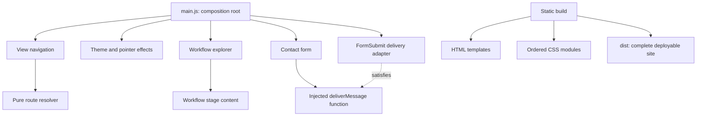

# Architecture

This is a static, progressively enhanced portfolio. The build produces complete HTML, one stylesheet and native JavaScript modules. There is no framework, application server, dependency container or browser secret.

## Dependency direction

Clean architecture is applied through feature ownership and dependency direction. Browser features receive the capabilities they use. Contact behavior depends on a delivery function, rather than importing a provider. Only the composition root connects that function to FormSubmit. A pure route resolver can be tested without a browser. There is little business logic here, so a separate domain tier would add unnecessary indirection.

The two fitting patterns are a **composition root** for startup and **ports and adapters** for external email delivery. Features communicate through an explicit callback and a small returned interface, rather than a global event bus.

## Browser modules

| Module | Interface and ownership |
| --- | --- |
| `src/main.js` | Supplies real browser capabilities, initializes features once, coordinates navigation with dialog closing. |
| `scripts/navigation/view-navigation.js` | `initViewNavigation({ document, window, onViewChange })`; owns tab state, focus, indicator, history, deep-link scrolling and keyboard navigation. Reports selected view before changing panels. |
| `scripts/navigation/portfolio-routes.js` | `resolvePortfolioRoute(hash, { views, targets })`; resolves registered destinations and legacy aliases. No DOM, storage or network access. |
| `scripts/appearance/theme-controller.js` | `initTheme({ document, window })`; owns stored preference, accessible controls and motion-aware transitions. Blocked storage does not disable switching. |
| `scripts/appearance/pointer-effects.js` | `initPointerEffects({ document, window })`; optional decoration for fine pointers, disabled by reduced motion. |
| `scripts/workflow/workflow-explorer.js` | `initWorkflowExplorer({ document })`; owns selected stage and accessible details. Copy comes from `scripts/content/workflow-stages.js`. |
| `scripts/contact/contact-form.js` | `initContactForm({ document, window, deliverMessage, copyText })`; owns validation, dialog focus, clipboard feedback and the send lifecycle. Returns `close({ restoreFocus = true })`. |
| `scripts/contact/formsubmit-delivery.js` | `createFormSubmitDelivery({ fetch })`; returns the delivery adapter. Owns endpoint payload, HTTP options and provider-response interpretation. |

All paths in the table beginning with `scripts/` are relative to `src/`. Modules define functions at import time; only `main.js` starts browser behavior. Initializers are called once per page load. This site does not mount and unmount views, so it does not need a lifecycle framework.

Navigation never queries the contact dialog. `main.js` closes it with focus restoration disabled when another view is selected, so a hidden opener cannot steal focus from the destination.

### Routes

Current views are `#about`, `#experience` and `#contact`. Deep links include `#about-me`, `#tech-stack`, `#experience-email`, `#experience-calls` and `#experience-platform`. Saved `#home` links resolve to About; `#stack` and `#toolkit` resolve to Tech Stack. Unknown or malformed fragments fall back to About. The skip link targets `#main` independently.

### Contact delivery contract

The contact module passes `{ endpoint, draft, honeypot, pageUrl }` to `deliverMessage`. The adapter resolves to `accepted` only for an explicit successful acknowledgement, or `activation-required` when inbox activation is requested. HTTP failure, malformed JSON, null/unknown/rejected responses throw; the UI retains the draft and reports unconfirmed delivery.

The send lifecycle is **idle → pending → accepted / activation required / unconfirmed → idle**. Pending disables controls and prevents duplicate requests. After eight seconds, reassurance appears; the original request remains alive. There is no arbitrary client timeout. Closing the dialog does not cancel an in-flight request. `copyText(text)` resolves on a successful clipboard write and rejects when copying is unavailable.

The form owns its provider endpoint in `action` and its fallback address in `data-recipient`. Its labels, required fields, dialog IDs and `data-*` controls are explicit contracts checked in the production build. The provider processes visitor contact information; no mailbox password or API key is shipped to visitors.

## Content and styles

`src/index.html` is the document shell. Source-root-relative `<!-- include: templates/... -->` markers are expanded at build time. Shared document head, icons, header, footer, dialog and no-JavaScript fallback live in `templates/partials/`; top-level views live in `templates/pages/`; independently editable content blocks live in `templates/sections/`.

Templates are plain HTML, not JavaScript rendering functions. All approved content remains in the built document for search, accessibility and no-JavaScript reading. Build includes reject missing files, cycles and paths outside `src/`. No templates are fetched by the browser.

`src/styles.css` declares ordered imports of the modules in `src/styles/`. Feature-specific media queries live with their feature. Shared tokens and base rules come first; accessibility and print rules come last. The build expands local imports into one production stylesheet and rebases asset URLs. Keep the order deliberate: it is part of the cascade. The browser does not make a request for every source CSS module.

## Build and verification

`scripts/build.mjs` assembles HTML/CSS before replacing `dist/`, then copies runtime scripts, local assets and approved public files. Source templates and development documentation are not shipped as runtime assets. All output paths work at a domain root or a GitHub Pages project path.

`scripts/check.mjs` checks generated content, links, semantic controls, module syntax/import destinations, resolved includes, reduced-motion/focus styles and exact approved CV bytes. `scripts/lib/html-inspection.mjs` inspects controlled source markup; browser QA remains the authority for actual HTML behavior.

Tests import the same feature interfaces used by the site. Contact tests use real validation/controller/provider parsing with fake browser capabilities and HTTP. Navigation/theme tests simulate history, clocks, storage and transitions. Build tests cover nested includes, asset URL rebasing, missing files, cycles and source-directory escape attempts. No test sends a real email.

Run `npm run verify` before publication, followed by rendered desktop/mobile checks in both themes. See [Maintenance](MAINTENANCE.md) for edit locations and the release checklist.
